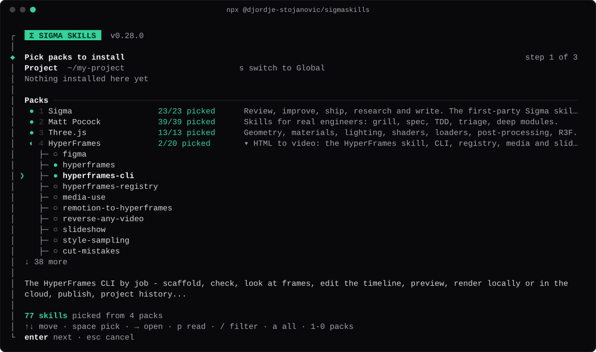
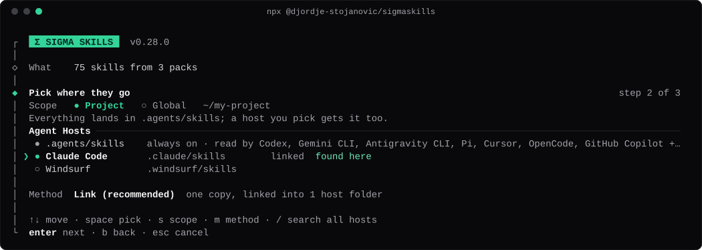
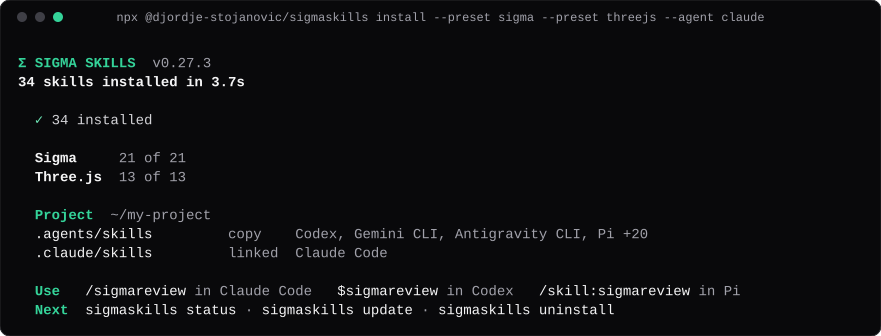

# SigmaSkills

[](https://www.npmjs.com/package/@djordje-stojanovic/sigmaskills) [](https://github.com/Djordje-Stojanovic/Sigmaskills/releases/latest) [](LICENSE)

Skills for coding agents. A skill is a folder with one `SKILL.md` that tells an agent how to do one job well: review a repo, ship a ticket, value a stock, read a video. Install once, then call a skill by name in Claude Code, Codex, Cursor, Pi, OpenCode or any host that reads [Agent Skills](https://agentskills.io/).

## Install

```bash
npx @djordje-stojanovic/sigmaskills
```

The wizard has three steps: What, Where, Review. It writes nothing until you confirm. Its first screen shows the scope (Project or Global) and what is installed there; `s` switches the scope, `u` updates every installed skill, `x` removes skills.







Every choice also has a flag, for scripts and CI:

```bash
npx @djordje-stojanovic/sigmaskills install --global --yes              # the core: every Sigma skill, Matt Pocock, tstack
npx @djordje-stojanovic/sigmaskills install --pack threejs --project .  # one pack into one repo
npx @djordje-stojanovic/sigmaskills install sigmawrite --project .      # one skill
npx @djordje-stojanovic/sigmaskills@latest update --global --yes        # move to the newest release
```

`update` never replaces a skill you edited without asking, and `update --check` lists what is out of date. Your own instructions for a skill go in `~/.agents/.sigmaskills/custom/<skill>.md`; edit them there, and every install and update writes them into each copy of that skill. A merge to `main` never publishes; updates come from npm releases. Every command and flag: the [installer guide](https://github.com/Djordje-Stojanovic/Sigmaskills/blob/main/docs/installer.md).

**No Node?** These lines copy every Sigma skill into `~/.claude/skills` for Claude Code. Run them again to update.

```bash
d=$(mktemp -d) && curl -fsSL https://github.com/Djordje-Stojanovic/Sigmaskills/archive/refs/heads/main.tar.gz | tar -xz -C "$d" --strip-components=1 && mkdir -p ~/.claude/skills && for s in "$d"/sigma*; do [ -f "$s/SKILL.md" ] && cp -R "$s" ~/.claude/skills/; done; rm -rf "$d"
```

```powershell
$t = "$env:TEMP\sigmaskills-src"; Remove-Item $t -Recurse -Force -ErrorAction SilentlyContinue; New-Item -ItemType Directory $t | Out-Null; curl.exe -fsSL -o "$t.tgz" https://github.com/Djordje-Stojanovic/Sigmaskills/archive/refs/heads/main.tar.gz; if ($LASTEXITCODE -eq 0) { tar -xzf "$t.tgz" -C $t --strip-components=1 }; if ($LASTEXITCODE -eq 0) { New-Item -ItemType Directory "$HOME\.claude\skills" -Force | Out-Null; Get-ChildItem $t -Directory -Filter sigma* | Where-Object { Test-Path "$($_.FullName)\SKILL.md" } | Copy-Item -Destination "$HOME\.claude\skills" -Recurse -Force }; Remove-Item $t, "$t.tgz" -Recurse -Force
```

The first line needs a POSIX shell (macOS, Linux, Git Bash); the second is for Windows PowerShell. Skills you turn on in claude.ai also load in Claude Code 2.1.273 or later when you sign in with that account, but not with an API key or on Amazon Bedrock ([how](https://code.claude.com/docs/en/skills#how-synced-skills-behave)).

Other routes: `npx skills add Djordje-Stojanovic/Sigmaskills --all -g -y` (the [skills](https://github.com/vercel-labs/skills) CLI), `$skill-installer install <id> from https://github.com/Djordje-Stojanovic/Sigmaskills` in Codex, or a manual copy of `<id>/` into `~/.agents/skills/` ([details](https://github.com/Djordje-Stojanovic/Sigmaskills/blob/main/docs/installer.md#other-install-methods)).

## The skills

Each skill has one job. Say its name to start it.

| Skill | What it does | Needs |
|-------|--------------|-------|
| `sigmaask` | Tells you which skill to use and what comes next. It looks at what is installed on your machine first, and knows every pack. | Node.js 22 |
| `sigmareview` | Finds and proves what is wrong in a repo (bugs, security, slow paths) and publishes one review PR. Never changes your code. | `gh` to push and open the PR |
| `sigmaimprove` | Compares a product with the top 1-3 in its field and keeps one living issue of ideas per category. Never edits the product. | |
| `sigmaship` | Ships one GitHub issue with checkable acceptance criteria: test-first PR, self-review (a reviewer only on request), merge, clean up. | `gh` with push rights |
| `sigmadebug` | Lists every open question, grills one topic at a time, plans each fix and ships it in a background agent. | |
| `sigmacorrect` | Turns a correction you gave twice into a type, a check or a test that fails on the real mistake; docs last. | |
| `sigmamusk` | Runs Musk's five-step Algorithm on a plan, a codebase (`cut`) or a whole setup (`reset`): measure, delete first, you decide what stays. | |
| `sigmaclimb` | Makes anything you can score or judge better, one kept-or-reverted change at a time, against a locked scorer and a quality check. | Python 3 |
| `sigmataste` | Looks at a page, app, deck, doc, image or film through 14 lenses and writes a ranked plan of visible changes. Plans; never builds. | A browser to see a page |
| `sigmatour` | A visual tour of any repo in one HTML page. On request it copies the repo first, isolated, and tours the copy. | Python 3, `git`, a browser |
| `sigmaresearch` | Reads public sources (Reddit, X, Hacker News, GitHub, Stack Overflow, YouTube, arXiv, SEC EDGAR, other languages) and counts only those read in full. | Python 3 |
| `sigmadeeplook` | Looks inside what an agent cannot read: video, audio, scans, hidden Excel sheets, SQLite, binaries. `--ask` gives one exact answer. | Python 3.10+; optional ffmpeg, tesseract and more (`look.py doctor`) |
| `sigmafinanceman` | Values any investment (a stock, a startup, a purchase, a home, gold, a collectible, a bond, a budget) and answers any money question, trades, options and taxes included. Fetches free live data and runs the model, or works it by hand where no code runs. | Python 3.10+ with `openpyxl` and `python-pptx` for the files |
| `sigmawrite` | Plain technical English for every reply, until you turn it off. "humanize" rewrites a draft to read like a person wrote it, every fact kept ([blader/humanizer](https://github.com/blader/humanizer)); "easy talk" adds an interactive status board. | Python 3 for the optional fact check |
| `sigmacourse` | Plans and builds a tutorial, guide or course of any size. It starts from what the learner can do at the end and derives the parts and the process from that. | |
| `sigmacreate` | Makes a new skill, public (proven free of personal data) or local to one repo or machine, and ends with it installed and picked up. | |
| `sigmacreatearena` | Ranks many options by your taste: blind pairs, Elo per metric. | Python 3, a browser |
| `sigmaloop` | Writes copy-pastable agent briefs in safe parallel waves, or a loop file and prompt for an unattended run (Claude Code, Codex, Antigravity, pi, T3 Code). Never starts the run. | |
| `sigmasetup` | Sets up a repo for the packs you installed and syncs your house files (`ENGINEERING.md`, `DESIGN.md`, `AGENTS.md` sections) from your masters. | Node.js |
| `sigmafreedom` | Deletes model-written refusals and moral limits from a repo's agent docs; a lint keeps them out. | Python 3 |
| `sigmacollab` | Runs one job on rented compute: a Google Colab runtime first (CPU, GPU, TPU), a vast.ai GPU when Colab refuses, or a boat.dev box for what Colab cannot hold. Shows the price first and proves the teardown. | The `boat`, `colab` or `vastai` CLI and its account |
| `sigmavast` | Points to `sigmacollab`. | - |

Every skill needs an agent that loads `SKILL.md`. Skills use the machine's own shell (PowerShell on Windows) and do not assume WSL.

Not sure which? Wrong by a test, a doc or a budget: `sigmareview`. Could be better, and people could disagree: `sigmaimprove`. Too big, same behavior: `sigmamusk cut`. How one thing looks or reads: `sigmataste`. Text that must sound human, or plain technical English: `sigmawrite`.

## Run

Use your host's skill syntax: `$sigmareview` in Codex, `/sigmareview` in Claude Code, `/skill:sigmareview` in Pi, or the skill picker elsewhere.

```text
$sigmareview https://github.com/owner/repo
$sigmaship https://github.com/owner/repo/issues/42
$sigmaloop Write briefs for all open issues
$sigmamusk Why does our test suite take 20 minutes?
$sigmaresearch Recent discussions about local language models
$sigmadeeplook What happens at 2:10 in demo.mp4?
$sigmafinanceman What does the price of KO assume?
$sigmafinanceman Should I buy or rent an H100 for six months?
$sigmatour Give me a 30 minute tour of this repo
$sigmaclimb Make my vLLM model serve faster on a rented H100
$sigmawrite Humanize this announcement so it sounds like me
$sigmaloop Write an overnight loop prompt for Claude Code until 07:00
```

## Packs

A pack is a group of skills from one or more sources, downloaded at its pinned version when you install it. `--pack <id>` installs a pack, a skill id installs one skill, and `--pack all` installs every pack. In the wizard, `p` shows a skill's full `SKILL.md` and `/design` (or any category) filters by category. What each pack needs on your machine, and how to set it up in a repo: its guide in [`sigmasetup/references/packs/`](https://github.com/Djordje-Stojanovic/Sigmaskills/tree/main/sigmasetup/references/packs).

| Pack | Id | Category | Skills | What it is | Source @ pin |
|------|----|----------|-------:|------------|--------------|
| Sigma | `sigma` | Engineering | 22 | The skills above | this package |
| Matt Pocock | `mattpocock` | Engineering | 39 | Grill, spec, TDD, triage, deep modules | [mattpocock/skills](https://github.com/mattpocock/skills) @ `abeeaf9` |
| Three.js | `threejs` | Media | 13 | Geometry, materials, lighting, shaders, R3F | [CloudAI-X/threejs-skills](https://github.com/CloudAI-X/threejs-skills) @ `0e18186` |
| HyperFrames | `hyperframes` | Media | 20 | HTML to video, plus the student kit | [heygen-com/hyperframes](https://github.com/heygen-com/hyperframes) @ `v0.9.86`, [nateherkai/hyperframes-student-kit](https://github.com/nateherkai/hyperframes-student-kit) @ `10511e5` |
| MiniMax H3 | `minimax-h3` | Media | 9 | Prompt writing and video recipes for MiniMax H3 | [MiniMax-AI/MiniMax-H3](https://github.com/MiniMax-AI/MiniMax-H3) @ newest commit |
| Anthropic | `anthropic` | Productivity | 19 | docx, pdf, pptx, xlsx, Claude API, MCP builder, skill creator | [anthropics/skills](https://github.com/anthropics/skills) @ `e4bb5d9` |
| Design.md | `design-md` | Design | 84 | One brand `DESIGN.md` per skill, at most 3 installed | [VoltAgent/awesome-design-md](https://github.com/VoltAgent/awesome-design-md) @ `fcc7028` |
| Last 30 Days | `last30days` | Research | 1 | What people said about a topic in the last 30 days | [mvanhorn/last30days-skill](https://github.com/mvanhorn/last30days-skill) @ `v4.6.0` |
| Financial Services | `financial-services` | Finance | 99 | Anthropic's finance plugins: DCF, LBO, comps, decks, KYC | [anthropics/financial-services](https://github.com/anthropics/financial-services) @ `3e32c22` |
| tstack | `tstack` | Engineering | 9 | Theo Browne's PR skills: full-send, council, babysit-pr | [t3dotgg/tstack](https://github.com/t3dotgg/tstack) @ `11e37a7` |
| Superpowers | `superpowers` | Engineering | 15 | Brainstorm, plan, execute, TDD, debug, review | [obra/superpowers](https://github.com/obra/superpowers) @ `22f0b46` |
| Impeccable | `impeccable` | Design | 1 | Audit, polish, critique and restyle a frontend | [pbakaus/impeccable](https://github.com/pbakaus/impeccable) @ `b49177d` |
| Security Audit | `security-audit` | Engineering | 1 | Find vulnerabilities and verify each one | [cloudflare/security-audit-skill](https://github.com/cloudflare/security-audit-skill) @ `c1c8a8c` |
| Anatomy | `anatomy` | Design | 1 | Interactive isometric drawings of real machines | [wheresryan22/anatomy](https://github.com/wheresryan22/anatomy) @ `1482e84` |
| Diagram Design | `diagram-design` | Design | 1 | Editorial diagrams as HTML and SVG | [cathrynlavery/diagram-design](https://github.com/cathrynlavery/diagram-design) @ `0eeda75` |
| Taste | `taste-skill` | Design | 1 | Art direction so a page does not look generated | [Leonxlnx/taste-skill](https://github.com/Leonxlnx/taste-skill) @ `6c0b5c7` |
| Hallmark | `hallmark` | Design | 1 | New pages, audits and redesigns without the AI look | [Nutlope/hallmark](https://github.com/Nutlope/hallmark) @ `04977e1` |
| Ponytail | `ponytail` | Engineering | 6 | The smallest change that fully works, plus audits | [DietrichGebert/ponytail](https://github.com/DietrichGebert/ponytail) @ `v5.3.3` |
| Anthropic Engineering | `anthropic-engineering` | Engineering | 9 | Architecture, debugging, incidents, system design | [anthropics/knowledge-work-plugins](https://github.com/anthropics/knowledge-work-plugins) @ `2baf6d1` |
| Agent Skills | `agent-skills` | Engineering | 25 | Addy Osmani's spec-to-ship workflow | [addyosmani/agent-skills](https://github.com/addyosmani/agent-skills) @ `8c99fa3` |
| Caveman | `caveman` | Engineering | 14 | Terse answers, lean build and verify skills | [JuliusBrussee/caveman](https://github.com/JuliusBrussee/caveman) @ `b89752f` |
| Claude Red | `claude-red` | Engineering | 79 | Offensive security for authorized tests | [SnailSploit/Claude-Red](https://github.com/SnailSploit/Claude-Red) @ `6196ba7` |
| Dev Browser | `dev-browser` | Engineering | 1 | The agent drives a real Chrome | [SawyerHood/dev-browser](https://github.com/SawyerHood/dev-browser) @ `520ba5c` |
| Emil Kowalski | `emil-kowalski` | Design | 19 | Animation, gestures and UI reviews | [emilkowalski/skills](https://github.com/emilkowalski/skills) @ `64eb3de` |
| Marketing Skills | `marketingskills` | Marketing | 53 | Copy, SEO, CRO, ads, email, launches | [coreyhaines31/marketingskills](https://github.com/coreyhaines31/marketingskills) @ `8fd2fca` |
| LinkedIn | `linkedin` | Marketing | 12 | Posts, comments and analytics, drafted for approval | [sergebulaev/linkedin-skills](https://github.com/sergebulaev/linkedin-skills) @ `32083c0` |
| I Have ADHD | `i-have-adhd` | Productivity | 1 | Answers shaped for a reader with ADHD | [ayghri/i-have-adhd](https://github.com/ayghri/i-have-adhd) @ `1ecea19` |
| Baoyu | `baoyu` | Media | 21 | Covers, infographics, comics, slides, posting to X | [Djordje-Stojanovic/baoyu-skills](https://github.com/Djordje-Stojanovic/baoyu-skills) @ `5847f0a` (English fork of [JimLiu/baoyu-skills](https://github.com/JimLiu/baoyu-skills)) |
| Game Dev | `gamedev` | Engineering | 80 | Games in 12 engines, with a router | [gamedev-skills/awesome-gamedev-agent-skills](https://github.com/gamedev-skills/awesome-gamedev-agent-skills) @ `c6ca6c4` |
| Monorepo Doctor | `monorepo-doctor` | Engineering | 2 | Read-only JS/TS monorepo audit and cleanup | [santoshyadavdev/monorepo-doctor](https://github.com/santoshyadavdev/monorepo-doctor) @ `3cb32ea` |
| Design Kit | `design-kit` | Design | 2 | Logos from brief to files; editorial charts, decks and reports | [kaankiziltug/logo-design-skill](https://github.com/kaankiziltug/logo-design-skill) @ `e9eaddc`, [larashero3-dotcom/lieflat-charts](https://github.com/larashero3-dotcom/lieflat-charts) @ `4b4e75b` |
| Motion Kit | `motion-kit` | Media | 2 | Logo animation from a raster logo; animated line-art scenes | [nolangz/pixel2motion](https://github.com/nolangz/pixel2motion) @ `e9faedb`, [JDhruv14/line-art-animation](https://github.com/JDhruv14/line-art-animation) @ `c43d698` |
| Engineering Kit | `engineering-kit` | Engineering | 1 | Local LLM inference hill-climbing under a memory cap | [sybil-solutions/inference-optimisation-skill](https://github.com/sybil-solutions/inference-optimisation-skill) @ `fda968e` |

`local` is a folder of your own skills (`SIGMA_LOCAL_SKILLS_DIR` or `~/.sigmaskills/packs.json`). When two packs ship the same skill name, the earlier pack in this table keeps it. `npx @djordje-stojanovic/sigmaskills packs` prints every pack with its skills.

Checked and left out, because their skills break outside their own repo: [gstack](https://github.com/garrytan/gstack), [Agent Reach](https://github.com/Panniantong/Agent-Reach) and [Academic Research Skills](https://github.com/Imbad0202/academic-research-skills). Graphify ships no `SKILL.md`; its own tool installs its skill (`uv tool install graphifyy && graphify install`).

## Ponytail per project

[Ponytail](https://github.com/DietrichGebert/ponytail) tells coding agents to write the smallest code that works. This turns it on for one repo in Claude Code, Codex and Pi, pinned to v5.3.3; other repos stay as they are.

```bash
npx @djordje-stojanovic/sigmaskills ponytail --project .           # on
npx @djordje-stojanovic/sigmaskills ponytail --check --project .   # on or off per agent
npx @djordje-stojanovic/sigmaskills ponytail --remove --project .  # off
```

Codex also needs `codex plugin marketplace add DietrichGebert/ponytail` once per machine.

## Links

- [Installer guide](https://github.com/Djordje-Stojanovic/Sigmaskills/blob/main/docs/installer.md): every command, flag and install method
- [CHANGELOG.md](CHANGELOG.md): what changed in each release
- [Maintainer guide](https://github.com/Djordje-Stojanovic/Sigmaskills/blob/main/docs/maintainers.md): tests, releases and registry automation
- [Skill evals](https://github.com/Djordje-Stojanovic/Sigmaskills/blob/main/docs/evals.md): how each skill's output is checked
- [CONTEXT.md](https://github.com/Djordje-Stojanovic/Sigmaskills/blob/main/CONTEXT.md): the words this project uses
- [Decision records](https://github.com/Djordje-Stojanovic/Sigmaskills/tree/main/docs/adr): why the installer works the way it does
- [New issue](https://github.com/Djordje-Stojanovic/Sigmaskills/issues/new/choose)

[MIT](LICENSE) © Djordje Stojanovic
