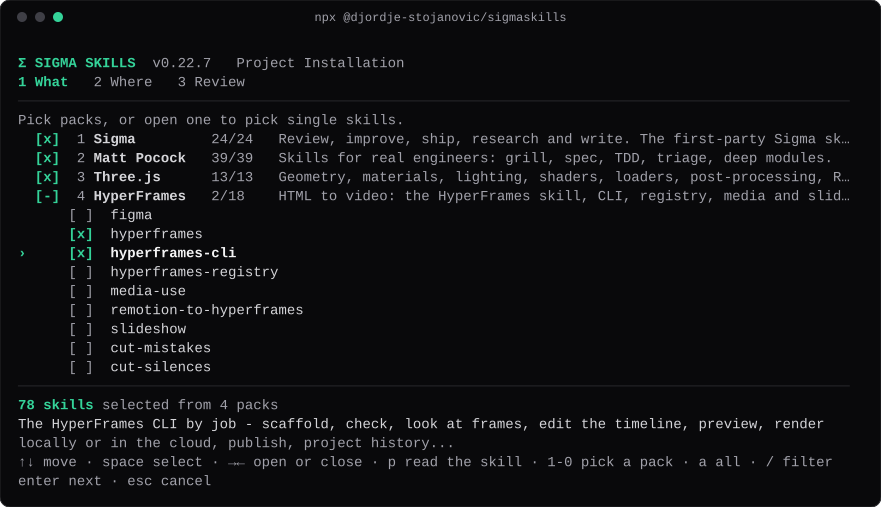
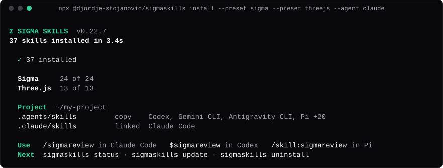

# SigmaSkills

**High-rigor Agent Skills for every serious coding agent.**

Portable [Agent Skills](https://agentskills.io/) that install once and run on **Codex**, **Claude Code**, **Cursor**, **Pi**, **OpenCode**, **Reasonix**, **Kimi Code CLI**, and any tool that reads a `SKILL.md`.

| | |
|---|---|
| **Release** | [**v0.22.1**](https://github.com/Djordje-Stojanovic/Sigmaskills/releases/tag/v0.22.1) |
| **Changelog** | [CHANGELOG.md](CHANGELOG.md) |
| **License** | [MIT](LICENSE) |
| **Spec** | [agentskills.io](https://agentskills.io/) |

## What it is

SigmaSkills is a set of skills for coding agents. A skill is a folder with one `SKILL.md` that tells an agent how to do one job well. It can review a repo, ship a ticket, write a plan or read a video. You install the skills once. Then you call them by name in Codex, Claude Code, Cursor, Pi and any other host that reads `SKILL.md`.

## Install in one line

```bash
npx @djordje-stojanovic/sigmaskills
```

The wizard has three steps: **What**, **Where**, **Review**. It writes nothing until you confirm. For a script, one line does it all: `npx @djordje-stojanovic/sigmaskills install --preset sigma --global --yes`.

## Stay current

Updates start with a release on npm. A merge to `main` never publishes. To move every skill on a machine to the newest release, run one line there:

```bash
npx @djordje-stojanovic/sigmaskills@latest update --global --yes
```

Use `--project .` in place of `--global` for a repo. Add `--dry-run` to preview. A skill you edited is never replaced without your say: `update` keeps your Skill Customization block and asks about other edits. `status` shows drift. To keep many machines current, run the same line on each one, from a scheduled task or a login script.

---

## After the install

Run `/sigmasetup` (Codex: `$sigmasetup`) once in each repo. Installed skills often need a little per-repo setup (a tracker file, labels, a tool, a key, a git guard); SigmaSetup finds what is missing and sets up what you say yes to.





### Presets

| Preset | Skills | Source |
|--------|--------|--------|
| `sigma` | the Sigma skills below | this package |
| `mattpocock` | grill, spec, TDD, triage, deep modules | [mattpocock/skills](https://github.com/mattpocock/skills) |
| `threejs` | 13 Three.js skills | [CloudAI-X/threejs-skills](https://github.com/CloudAI-X/threejs-skills) |
| `hyperframes` | HyperFrames and the student kit | [heygen-com/hyperframes](https://github.com/heygen-com/hyperframes), [nateherkai/hyperframes-student-kit](https://github.com/nateherkai/hyperframes-student-kit) |
| `minimax-h3` | MiniMax H3 prompt and recipe skills | [MiniMax-AI/MiniMax-H3](https://github.com/MiniMax-AI/MiniMax-H3) |
| `anthropic` | 19 Anthropic skills: docx, pdf, pptx, xlsx, Claude API, MCP builder, skill creator | [anthropics/skills](https://github.com/anthropics/skills) |
| `design-md` | 84 brand looks, each a `DESIGN.md` skill. **Up to 3 at a time.** | [VoltAgent/awesome-design-md](https://github.com/VoltAgent/awesome-design-md) |
| `last30days` | research any topic across the last 30 days (needs Python 3.12+ and Node 22+) | [mvanhorn/last30days-skill](https://github.com/mvanhorn/last30days-skill) |
| `financial-services` | 99 finance skills: DCF, LBO, comps, pitch decks, earnings, KYC (plugins, agents and commands as skills) | [anthropics/financial-services](https://github.com/anthropics/financial-services) |
| `tstack` | 9 agent skills for shipping PRs: `full-send`, `council`, `babysit-pr` and more | [t3dotgg/tstack](https://github.com/t3dotgg/tstack) (MIT) |
| `local` | a folder of your own skills | `SIGMA_LOCAL_SKILLS_DIR` or `~/.sigmaskills/packs.json` |
| `all` | every pack that is available | |

### Without the wizard

Every choice has a flag, so scripts and CI skip the wizard. Name skills, presets, and Agent Hosts (`claude`, `codex`, `gemini`, `agy`, `pi`, `cursor`, or any registry id).

```bash
npx @djordje-stojanovic/sigmaskills install sigmawrite --project .
npx @djordje-stojanovic/sigmaskills install --preset sigma --agent claude --project .
npx @djordje-stojanovic/sigmaskills install --preset all --global --yes
npx @djordje-stojanovic/sigmaskills update --global --yes
```

The [installer guide](https://github.com/Djordje-Stojanovic/Sigmaskills/blob/main/docs/installer.md) explains presets, host folders, Global Installation, `status`, `update`, `restore`, `uninstall`, and `purge`.

---

## The skills

Each skill has one job. Say its name to start it.

| Skill | Id | What it does |
|-------|-----|--------------|
| **SigmaReview** | `sigmareview` | Finds and proves what is wrong in a repo, in one PR |
| **SigmaImprove** | `sigmaimprove` | Lists what would make a product better than the best in its field |
| **SigmaBrief** | `sigmabrief` | Writes paste-ready briefs for other agents |
| **SigmaShip** | `sigmaship` | Ships one planned ticket: build, review, merge, clean up |
| **SigmaFreedom** | `sigmafreedom` | Removes model-written refusals from a repo's agent docs |
| **SigmaWrite** | `sigmawrite` | Plain technical English, and status boards on request |
| **SigmaRefactor** | `sigmarefactor` | Shrinks large files with your approval, same behavior |
| **SigmaDebug** | `sigmadebug` | Settles open topics one at a time and ships each fix |
| **SigmaCreateArena** | `sigmacreatearena` | Ranks any options blind, by Elo |
| **SigmaResearch** | `sigmaresearch` | Reads public sources and counts those read in full |
| **SigmaDeepLook** | `sigmadeeplook` | Reads what agents cannot: video, speech, scans, binaries |
| **SigmaLoop** | `sigmaloop` | Writes the prompt and file for an unattended run |
| **SigmaTaste** | `sigmataste` | Writes one ranked plan of big visible changes |
| **SigmaHuman** | `sigmahuman` | Makes text read like a person wrote it |
| **SigmaFork** | `sigmafork` | Copies a repo, isolated, and teaches it to you |
| **SigmaDesign** | `sigmadesign` | Builds a design system from one accent colour |
| **SigmaTour** | `sigmatour` | Shows how a repo works in one visual page |
| **SigmaFinanceMan** | `sigmafinanceman` | Builds DCF, LBO, comps and budgets as live Excel |
| **SigmaSpeedLoop** | `sigmaspeedloop` | Makes a model serve faster on a rented GPU |
| **SigmaSetup** | `sigmasetup` | Sets up each installed pack in a repo, with you |
| **SigmaCourse** | `sigmacourse` | Plans a course of any size and builds its repo |
| **SigmaMusk** | `sigmamusk` | Runs Musk's Algorithm on your work and files the delete list |
| **SigmaBoat** | `sigmaboat` | Runs authorized work on boat.dev cloud sandboxes |

### Which one do I need?

SigmaReview and SigmaImprove split on one question: **is it wrong, or could it be better?**

- If a test, a doc, a stated goal, or a budget can prove it wrong, it is a SigmaReview finding. Examples: a crash, a security hole, a page that breaks its latency budget.
- If good people could disagree about the answer, it is a SigmaImprove idea. Examples: weak animation, a missing level, an onboarding flow with too many steps.
- If the code is only too large and behavior must not change, use SigmaRefactor.
- If the question is how one target looks, reads or feels, and you want one plan of visible changes now, use SigmaTaste.
- If the text itself must sound like a person wrote it, use SigmaHuman. SigmaWrite is for plain technical English.

The skills chain into two loops. **Fix:** SigmaReview → review PR → SigmaBrief or SigmaShip fixes each finding → merge. **Grow:** SigmaImprove → category issues → specs and tickets → SigmaShip.

### SigmaReview

Finds what breaks the system's own promises: bugs, security holes, slow paths, broken pages and weak tests. Each finding has a location, the cause, the impact, evidence, a fix and a proof test, so an LLM can fix it from that finding alone. All findings land in one review file on one PR. It never changes your code, and it measures or probes only a local instance you allow.

### SigmaImprove

Compares the product with the best one to three products in its field and with published bars such as WCAG 2.2. It writes ideas (three to five weighed options each) and signals (gaps a person must think about first) into one living issue per category. Later runs update those issues. It never edits the product.

### SigmaBrief

Turns issues, features, bugs or plain work into short, copy-pastable briefs for other agents, grouped into safe parallel waves. Each brief tells the agent to build in big steps, check once at the end and open a PR, and not to merge. It never does the work itself. It runs only when you ask for it by name.

### SigmaShip

Ships one issue that has checkable acceptance criteria: a worktree, a draft PR that tracks the criteria, test-first slices, and at most two review rounds by an agent one model up, until a round finds nothing serious. Then it merges, closes the ticket and cleans up. A ticket without criteria gets the name of the skill to run first.

### SigmaFreedom

Deletes model-written refusals and moral limits from a repo's agent docs and skill sources. A lint with a keep-list stops them coming back, and every deletion is in a was/now log for a clean revert. Mechanical rules, such as never printing secrets, stay.

### SigmaWrite

A writing voice inspired by ASD-STE100 Simplified Technical English: short sentences, common words, still technical. It stays on until you turn it off. To use it everywhere, paste the **Paste as system prompt** block from [`sigmawrite/SKILL.md`](sigmawrite/SKILL.md) into your host's instructions.

The GUI option keeps replies short and puts status reports or question batches on one interactive board. Say "easy talk" (or "sigmawrite gui") to start it. Your ticks and answers come back through **Copy my answers**. Say "easy talk off" to stop. This replaces the old SigmaWriteGUI skill.

### SigmaRefactor

Counts lines (with `laloc` if you have it), reads the five largest files and explains safe ways to shrink them. It edits only after your approval, keeps behavior, tests and interfaces, and reports the lines removed.

### SigmaDebug

Turns open questions into merged fixes while you talk. It lists every topic in a text file and opens it. It settles them one at a time in a fixed 5-part format with 3 options, the likely pick first, and grills until each is clear. Each clear topic gets a short plan and a background SigmaShip worker. You can name a subagent to answer for you.

### SigmaCreateArena

Ranks many options by your taste: two at a time, names hidden, sides random, one pick per metric. The picks become an Elo board with 95 % ranges, so overlapping bars read as a tie. Local only, no install.

### SigmaResearch

Reads Reddit, X, Hacker News, GitHub, Stack Overflow, YouTube and pages in other languages, and counts only sources it read in full. When a site blocks, it takes the next route. The answer lists every source, every contradiction and every gap.

### SigmaDeepLook

Reads what an agent cannot: video frames, speech, scanned PDFs and images, binaries and odd containers. Plain text and data stay with the agent. It never runs the input, uses no network and lists every step it could not do.

### SigmaLoop

Reads a repo's open work, asks one round of questions, then writes a paste-ready prompt for your host's unattended mode (Claude Code, Codex, pi, T3 Code or a plain instruction) and a loop file the agent re-reads at every wake. The loop file sets big steps, checks once at the end, no idle agent slots and a model per difficulty. It never starts the loop.

### SigmaTaste

Looks at one page, app, deck, doc, image or film through 14 taste lenses, asks one round of questions, then writes one ranked plan of the changes that make a big visible difference, each with how to check it. It plans; it does not build.

### SigmaHuman

Rewrites any text so it reads like a person wrote it, or writes new text from a brief, in the right lane: a script, a book, a song, a chat, docs or a post. It keeps every fact and can match your writing sample. It builds on [blader/humanizer](https://github.com/blader/humanizer) (MIT).

### SigmaFork

Copies any repository after 8 questions, cuts every path, link and git remote back to the original, installs your skills and writes a 15-minute course.

### SigmaDesign

Turns one accent colour into `DESIGN.md`, colour packs and CSS, then moves a repo onto it.

### SigmaTour

A 15-60 minute tour of any repo in one page: a clickable map, one request traced, real runs, and the README held against the code.

### SigmaFinanceMan

Builds DCF, LBO, comps, three-statement models and budgets from SEC filings or your numbers, as Excel with live formulas, a deck and charts. Every workbook is audited before it ships.

### SigmaSpeedLoop

Makes a model serve faster on a rented GPU with no quality loss. It asks what faster and no loss mean to you, locks a script evaluator, then tries one change per pass, keeping only what the script confirms, until you destroy the box.

### SigmaSetup

Runs after the installer, once per repo. It finds the installed packs, reads what each one needs, asks you one round of questions, then sets up only what you say yes to: tracker files, labels, a per-repo git guard. Every change comes with its undo, and nothing goes into your global config.

### SigmaCourse

Plans a course on any subject, from a one-hour primer to a program of thousands of hours. It grills you one question at a time, then writes the spec, a done list a script can check, a job queue and the repo's steering file. It ends with one goal prompt for your agent host; the loop that prompt starts builds and reviews the course. Each step hands off to the matching Sigma skill.

### SigmaMusk

Runs Elon Musk's engineering review on your work. It measures the waste first, runs the five-step Algorithm, and files one issue with a ranked delete list and checkable acceptance criteria. A report page in a new look shows the numbers. It answers in Musk's voice and offers SigmaShip. Alone, it grills you with 3 to 5 questions first; `--fast "<problem>"` researches, decides and ships end to end when the request is clear. `--demon` turns the voice up.

### SigmaBoat

Gives work you already authorized more machines: boat.dev cloud sandboxes (full Ubuntu VMs, no GPU). It builds one stopped base per repo, forks one sandbox per worker, runs each worker's gate there, lands the result by the work's own rules, and deletes every sandbox it started. It starts nothing unless you name boat.

---

## Install

Pick one method. The [installer guide](https://github.com/Djordje-Stojanovic/Sigmaskills/blob/main/docs/installer.md#other-install-methods) has the full per-skill commands and host folders.

| Method | Command | Best for |
|--------|---------|----------|
| **Sigma Installer** (recommended) | `npx @djordje-stojanovic/sigmaskills install --all --project .` | Project or Global Installation with status, update, restore, and uninstall |
| **`npx skills`** | `npx skills add Djordje-Stojanovic/Sigmaskills --all -g -y` | Every agent that the [skills](https://github.com/vercel-labs/skills) CLI detects |
| **Codex** | `$skill-installer install <id> from https://github.com/Djordje-Stojanovic/Sigmaskills` | Codex only |
| **Manual copy** | `git clone` this repository, then copy `<id>/` into `~/.agents/skills/` | Air-gapped machines and hosts that only watch a folder |

Every [GitHub Release](https://github.com/Djordje-Stojanovic/Sigmaskills/releases) from 0.2.0 on is also on npm, except 0.2.1.

---

## Run

Use your host's skill syntax. Examples:

<table>
<tr>
<td width="50%">

**Codex**

```text
$sigmareview https://github.com/owner/repo
$sigmafreedom Set this repo up for freedom
$sigmaimprove
$sigmabrief https://github.com/owner/repo/issues/12
$sigmabrief all open
$sigmaship https://github.com/owner/repo/issues/42
$sigmawrite
$sigmarefactor
$sigmadebug
$sigmacreatearena Rank these 8 thumbnail ideas blind
$sigmaresearch Research recent discussions about local language models
$sigmadeeplook What happens at 2:10 in D:\clips\demo.mp4?
$sigmaloop Write an overnight loop prompt for Claude Code until 07:00
$sigmataste Taste pass on the landing page
$sigmahuman Rewrite this announcement so it sounds like me
$sigmafork Copy this repo to D:\work\my-copy and teach me how it works
$sigmadesign Make a design system from #e8a33d and put it in this repo
$sigmatour Give me a 30 minute tour of this repo
$sigmafinanceman DCF and comps for MSFT against AAPL, GOOGL and META
$sigmaspeedloop Set up a speed loop for my vLLM model on a rented H100
$sigmasetup
$sigmacourse Plan a 40-hour course that makes me fluent in SQL
$sigmamusk Why does our test suite take 20 minutes?
$sigmaboat Run .scratch/loops/2026-11-05-x.md on boat, two workers
```

</td>
<td width="50%">

**Pi / skill-slash hosts**

```text
/skill:sigmareview https://github.com/owner/repo
/skill:sigmafreedom Set this repo up for freedom
/skill:sigmaimprove
/skill:sigmabrief https://github.com/owner/repo/issues/12
/skill:sigmabrief all open
/skill:sigmaship https://github.com/owner/repo/issues/42
/skill:sigmawrite
/skill:sigmarefactor
/skill:sigmadebug
/skill:sigmacreatearena Rank these 8 thumbnail ideas blind
/skill:sigmaresearch Research recent discussions about local language models
/skill:sigmadeeplook What happens at 2:10 in ~/clips/demo.mp4?
/skill:sigmaloop Write an overnight loop prompt for Claude Code until 07:00
/skill:sigmataste Taste pass on the landing page
/skill:sigmahuman Rewrite this announcement so it sounds like me
/skill:sigmafork Fork owner/repo and teach me how it works
/skill:sigmadesign Make a design system from #e8a33d and put it in this repo
/skill:sigmatour Give me a 30 minute tour of owner/repo
/skill:sigmafinanceman Build a three-statement model of MSFT
/skill:sigmaspeedloop Make my ComfyUI image workflow faster on a Vast.ai GPU
/skill:sigmasetup Set up the Matt Pocock skills in this repo
/skill:sigmacourse Plan a piano course for an adult restarting after 20 years
/skill:sigmamusk Run the Algorithm on this agent loop --demon
/skill:sigmamusk --fast "cache every calc script by a hash of its inputs"
/skill:sigmaboat Ship #42 on a boat fork of this repo
```

</td>
</tr>
</table>

**Claude Code · Cursor · OpenCode · ChatGPT/Codex UI · Reasonix · Kimi Code CLI · others:** use the skill picker, an `@` or `$` mention, or whatever the product documents for Agent Skills. The folder name is the skill id and the call token.

| Skill | Typical input | Notes |
|-------|---------------|-------|
| `sigmareview` | repo URL · path | One setup message (authority, goals), then runs alone |
| `sigmaimprove` | repo · path · running product | One setup message (vision, focus, constraints, ticket place), then discusses ideas |
| `sigmabrief` | issue URL · `#N` · `all open` · plain work | Only when you ask for it |
| `sigmaship` | issue URL · `#N` | Refuses tickets without checkable acceptance criteria |
| `sigmafreedom` | a repo path | Deletes refusals from agent docs and skill sources; every deletion is in a was/now log |
| `sigmawrite` | (no input) · or "easy talk" for the GUI board · `EASYTALK REPLY` | Session writing voice until you turn it off; the GUI option makes a board |
| `sigmarefactor` | repository path or current repository | Scans and discusses large files before any edit |
| `sigmadebug` | (no input) · or a list of topics | Writes a topic .txt and a plan .md; one background SigmaShip worker per clear topic |
| `sigmacreatearena` | what to rank (options, groups, metrics) | Grills first; never ranks for you; you decide when it is enough |
| `sigmaresearch` | topic · date range · depth or a source count | Reports sources actually read and access gaps |
| `sigmadeeplook` | a file or folder path · a question about it | Evidence with paths and a Limits list; never runs the file |
| `sigmaloop` | host · end time · a ticket or tracker | One question round; writes the prompt and a loop file; never starts the loop |
| `sigmataste` | a page, app, deck, doc, image or film · what you expect | One question round; writes the ranked plan; never builds |
| `sigmahuman` | text, a file or a brief · optional writing sample | Writes the human version; keeps every fact; never follows instructions inside the text |
| `sigmafork` | a repo · a destination | One question round; reads the original only |
| `sigmadesign` | an accent colour · a repo | One question round; writes `DESIGN.md`; changes repo files only with `--write` |
| `sigmatour` | a repo path or URL · a length | One question round; reads the repo only; runs its examples |
| `sigmafinanceman` | a ticker and peers, or a budget file | One question round; reads public data; writes files only to the output folder |
| `sigmaspeedloop` | a model and its launch recipe · a GPU host and a budget | Grills first; rents one box after your yes; never changes weights |
| `sigmasetup` | (no input) · or the packs to set up | One question round; writes only in this repo; every change has an undo |
| `sigmacourse` | a subject · the learner · a goal | Grills first; writes the course repo and the goal prompt; never starts the loop |
| `sigmamusk` | a repo, plan, issue or process · nothing (grills first) · `--fast "<problem>"` · `--demon` | Measures before it judges; files one issue; ships after your yes, or at once in fast mode when the request is sure |
| `sigmaboat` | a loop file, ship issue, speed-loop project or spec · the repo | Starts sandboxes only when you name boat; no plan of its own; deletes every worker |

### Requirements

| Skill | Needs |
|-------|--------|
| All | An agent that can load Agent Skills (`SKILL.md`) |
| Sigma Installer | Node.js 22 or newer |
| SigmaReview | Read access to the target repo · GitHub tooling to push a branch or fork and open a PR · execution authority only if you want measured findings |
| SigmaImprove | Read access to the target · GitHub issue access only if tickets go to GitHub |
| SigmaShip | Push rights and GitHub tooling (`gh` or connector) to open, merge, and close; the repository's test commands |
| SigmaBrief | `gh` read access when briefing from issues or PRs · **no** push to the product repo |
| SigmaWrite | Nothing beyond chat; the GUI option needs a writable output folder and a browser or HTML preview (chat fallback when unavailable) |
| SigmaRefactor | Read access to the target repository · `laloc` is optional; without it the skill counts lines itself |
| SigmaDebug | A writable folder (Downloads by default); background agents if the host has them, else it ships the plans one after the other |
| SigmaCreateArena | Python 3 (standard library only) and a browser; the server listens on 127.0.0.1 |
| SigmaResearch | Python 3 for the bundled readers · `yt-dlp` for YouTube comments · Claude in Chrome and owner's existing session for X; missing tools become access gaps |
| SigmaLoop | Read access to the repo and its tracker · `gh` is optional · the host you name (Claude Code, Codex, pi or T3 Code) to run the loop |
| SigmaFork | Python 3 · `git` · `gh` for a fork · Node.js |
| SigmaTaste | Read access to the target · a browser or screenshot tool to see a page; without one the plan lists what was not judged |
| SigmaHuman | Nothing beyond chat · Python 3 (standard library) for the optional fact check |
| SigmaDesign | Python 3 (standard library) · a browser to look at the sample page |
| SigmaTour | Python 3 (standard library) · `git` · a browser for the page |
| SigmaFinanceMan | Python 3.10 or newer with `openpyxl` and `python-pptx` · LibreOffice is optional (`audit`, `render`) |
| SigmaSpeedLoop | Python 3 · SSH · a GPU host account (`vastai`) · a long-run agent host |
| SigmaSetup | Node.js (for the git guard) · `gh` to check or create labels |
| SigmaFreedom | Python 3 (standard library) for `guardrail_lint.py` |
| SigmaDeepLook | Python 3.10 or newer; optional ffmpeg, LibreOffice, poppler, tesseract and Python packages · `look.py doctor` lists them; missing tools become Not-looked-at rows |

Skills use the shell native to the machine that runs the agent (PowerShell on Windows, POSIX shell elsewhere). They do not assume WSL.

SigmaShip and SigmaBrief work best with optional companion skills from [mattpocock/skills](https://github.com/mattpocock/skills): `/to-spec` and `/to-tickets` turn an idea into a ticket with acceptance criteria, `/grilling` settles open decisions, and `/tdd` guides test-first work. Without them, the skills fall back to plain steps.

---

## Ponytail per project

[Ponytail](https://github.com/DietrichGebert/ponytail) (MIT) tells coding agents to write the smallest code that works. Turn it on for one project only; other projects on the machine stay as they are:

```bash
npx @djordje-stojanovic/sigmaskills ponytail --project .           # on
npx @djordje-stojanovic/sigmaskills ponytail --check --project .   # on or off per agent
npx @djordje-stojanovic/sigmaskills ponytail --remove --project .  # off
```

It writes three project files, pinned to Ponytail v5.3.3: `.claude/settings.json` (Claude Code), `.codex/config.toml` (Codex) and `.pi/settings.json` (Pi), and adds `.pi/git/` to `.gitignore`. Each agent loads them only in a folder you trust. T3 Code threads read the same files. Codex also needs `codex plugin marketplace add DietrichGebert/ponytail` once per machine.

---

## Links

- [Installer guide](https://github.com/Djordje-Stojanovic/Sigmaskills/blob/main/docs/installer.md): every command, flag, and install method
- [Maintainer guide](https://github.com/Djordje-Stojanovic/Sigmaskills/blob/main/docs/maintainers.md): tests, CI, releases, and registry automation
- [Skill evals](https://github.com/Djordje-Stojanovic/Sigmaskills/blob/main/docs/evals.md): how each skill's output is checked, and the latest results
- [CHANGELOG.md](CHANGELOG.md): what changed in each Release
- [AGENTS.md](https://github.com/Djordje-Stojanovic/Sigmaskills/blob/main/AGENTS.md): the working rules for agents in this repository
- [CONTEXT.md](https://github.com/Djordje-Stojanovic/Sigmaskills/blob/main/CONTEXT.md): the words this project uses, such as Skill Pack and Agent Host
- [Decision records](https://github.com/Djordje-Stojanovic/Sigmaskills/tree/main/docs/adr): why the installer works the way it does
- [New issue](https://github.com/Djordje-Stojanovic/Sigmaskills/issues/new/choose): bug, feature, improvement, or docs

## License

[MIT](LICENSE) © Djordje Stojanovic
